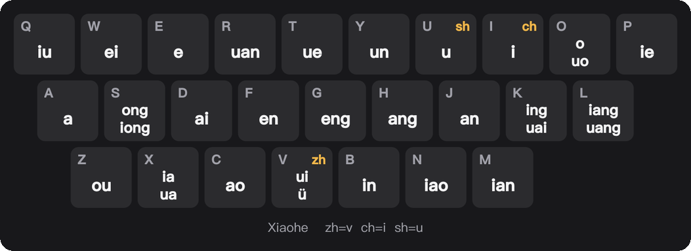
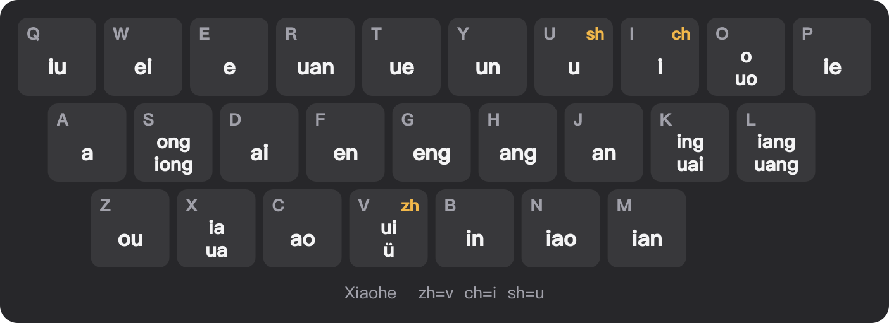
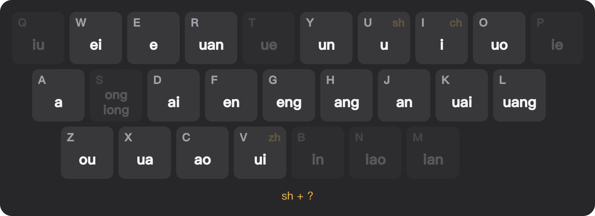
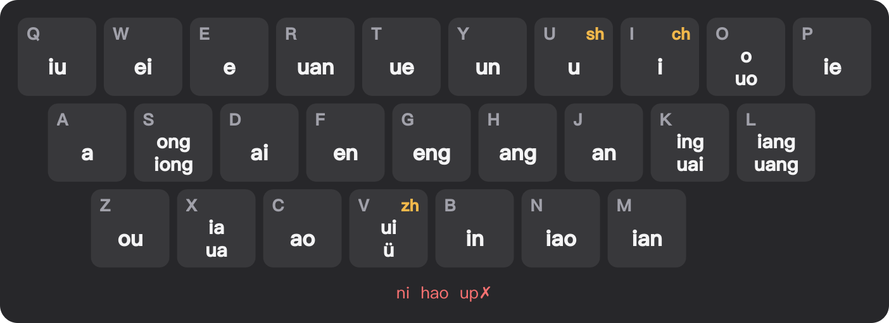

# Shuangpin Overlay

[简体中文](README.zh-CN.md)

A floating key chart for learning [Shuangpin](https://en.wikipedia.org/wiki/Pinyin_input_method#Shuangpin),
for Linux desktops. It stays on top of your windows, follows what you type, and gets out of the way when
you stop.



| | |
| --- | --- |
|  | At rest: every key with its finals, and zh, ch, sh in the accent colour. |
|  | After the first key of a syllable: only the finals that can follow it. |
|  | A pair that is not a syllable is marked in red. |

Pictures of all eight built-in schemes are in [docs/schemes.md](docs/schemes.md).

## Features

- **Eight schemes**: Xiaohe, Ziranma, Microsoft, Ziguang, Intelligent ABC, Zhongwenzhixing, Pinyin Jiajia
  and Guobiao. By default it uses whichever one Fcitx5 is set to. You can add your own.
- **Follows your typing**: pressed keys light up, and the bottom line spells out what you have typed so far
  (`vs go` → `zhong guo`). Pairs that are not a syllable are marked in red.
- **Hints the next key**: once an initial is typed, keys that cannot follow it are dimmed, and a key that
  carries two finals shows only the one that applies.
- **Stays out of the way**: it appears only while a Shuangpin input method is active, and hides after the
  keyboard has been idle for a while. While hidden, clicks pass through it.
- **Fades with you**: in "only appear when I get stuck" mode it stays hidden until you pause after an
  initial, so it disappears on its own as you get faster.
- **Tells you what to practise**: it lists the finals you are slowest to recall and the keys you mix up
  (found when you delete a key and type a different one in its place).
- Uses your desktop's accent colour. English and Simplified Chinese interface.

## Requirements

- Linux with Wayland or X11
- Qt 6.5 or newer
- Read access to `/dev/input/event*`, see [Keyboard access](#keyboard-access-and-privacy)
- Optional: [LayerShellQt](https://invent.kde.org/plasma/layer-shell-qt), for [overlay mode](#overlay-mode)
- Optional: Fcitx5, to follow the active input method and its scheme

The chart is an ordinary window, moved by your window manager like any other. Wayland does not let an
application keep itself above other windows, so that is set up once in the window manager:

| Desktop | Keeping it on top |
| --- | --- |
| KDE Plasma (Wayland) | A window rule, see [below](#keeping-it-on-top-in-kde-plasma). |
| GNOME (Wayland) | Window menu (Alt+Space) → *Always on Top*. |
| Sway, Hyprland and others | A rule for app id `io.github.zhenban.ShuangpinOverlay`, or the overlay mode below. |
| X11 | Nothing to do. |

Only KDE Plasma 6 on Wayland has been tested so far.

### Keeping it on top in KDE Plasma

1. Click the chart, press Alt+F3, and choose *More Actions → Configure Special Window Settings*.
2. Add these properties:
   - *Keep above other windows*: Force, Yes
   - *Accept focus*: Force, No. Without it, clicking the chart takes the keyboard away from what you were
     typing in.
   - *Position*: Remember
   - *Virtual Desktop*: Force, All Desktops. Without it, the chart stays behind when you switch desktops.
   - *Skip taskbar*: Force, Yes (optional)

### Overlay mode

With LayerShellQt, the menu offers *Float as an overlay*. The chart is then a layer-shell surface: on top,
never focused and remembering its position with no setting up. The price is that the window manager does
not move such surfaces, so dragging is done by the program itself: it is less smooth and has none of your
desktop's window effects. It also sits in the same layer as panels, and can cover them.

## Installing

**Fedora**: download the `.rpm` from the [latest release](https://github.com/zhenban/shuangpin-overlay/releases/latest)
and install it. Take the one for your Fedora version: `fc44` in the file name is Fedora 44.

```sh
sudo dnf install ./shuangpin-overlay-*.x86_64.rpm
```

**Other distributions**: build it from source as below. There are no packages yet; a package for yours is
welcome.

Either way, [keyboard access](#keyboard-access-and-privacy) has to be set up before the chart can follow
your typing.

## Building

Fedora:

```sh
sudo dnf install cmake ninja-build gcc-c++ qt6-qtbase-devel qt6-qttools-devel layer-shell-qt-devel
```

Debian and Ubuntu (a release with Qt 6.5 or newer; package names not verified):

```sh
sudo apt install cmake ninja-build g++ qt6-base-dev qt6-tools-dev qt6-l10n-tools liblayershellqtinterface-dev
```

Then:

```sh
cmake -B build -G Ninja
cmake --build build
ctest --test-dir build          # optional
cmake --install build --prefix ~/.local
```

Pass `-DWITH_LAYER_SHELL=OFF` to build without LayerShellQt.

## Usage

Start **Shuangpin Overlay** from your application menu, or run `shuangpin-overlay`.

| Action | Effect |
| --- | --- |
| Drag | Move the chart |
| Scroll | Change transparency |
| Ctrl + scroll | Change size |
| Right-click | Menu: scheme, hints, hiding, statistics, start at login, quit |

While the chart is hidden it cannot be clicked; type a letter in Shuangpin mode to bring it back.

Command line:

```sh
shuangpin-overlay --list-schemes
shuangpin-overlay --export chart.png --scheme ziranma       # save the chart as an image
shuangpin-overlay --export hint.png --after u               # ... as it looks after typing U
shuangpin-overlay --export typed.png --after nihcu --pressed u
```

`--after` takes the keys typed so far, with `<` for Backspace. The pictures in this README are made this way
by [`docs/generate.sh`](docs/generate.sh).

## Keyboard access and privacy

Wayland does not let an application see keys typed into other windows, so the overlay reads the kernel's
input devices directly. That requires membership of the `input` group:

```sh
sudo usermod -aG input "$USER"    # then log out and back in
```

Be aware of what this means: any program run by a member of that group can read every key press. Decide for
yourself whether that is acceptable on your machine.

What this program does with the keys:

- It looks at letter keys, `;`, Backspace and the modifier keys. Every other key only tells it that the
  current composition has ended.
- The keys of the composition in progress are held in memory and dropped when it ends.
- The only things written to disk are the practice statistics: an average recall time per final, and counts
  of "meant this key, hit that key". They are in `~/.local/share/shuangpin-overlay/stats.json` and can be
  cleared from the menu.
- Nothing is sent anywhere. There is no network code.

## Adding a scheme

Put a JSON file in `~/.local/share/shuangpin-overlay/schemes/` and restart. A file with the `id` of a
built-in scheme replaces it. The built-in files in [`data/schemes`](data/schemes) are the reference:

```json
{
  "id": "xiaohe",
  "name": { "en": "Xiaohe", "zh": "小鹤双拼" },
  "fcitxProfile": "Xiaohe",
  "initials": { "zh": "v", "ch": "i", "sh": "u" },
  "finals": { "ai": "d", "an": "j", "ü": "v", "üe": "t" },
  "zeroInitial": { "keys": "", "byFirstLetter": true }
}
```

- `initials`: the keys for zh, ch and sh. Single-letter initials are their own keys.
- `finals`: the key for each final of two or more letters, plus `ü`. The finals a, o, e, i and u are their
  own keys unless listed.
- `zeroInitial`: how syllables without an initial are typed. `keys` lists keys that stand for the missing
  initial (`"o"` in the Microsoft scheme: `oh` = ang). `byFirstLetter` is the Xiaohe and Ziranma way: `aa` =
  a, `an` = an, `ah` = ang.
- `fcitxProfile`: the value of `ShuangpinProfile` in Fcitx5's `pinyin.conf` that selects this scheme.

## Limitations

- Where you are inside a syllable is guessed from the keys alone: letters extend the composition, Backspace
  shortens it, anything else ends it. Fcitx5 does not expose this. Choosing a candidate with the mouse, or
  switching windows mid-word, can leave the hint one key out of step until the next Space.
- Slips are only seen before text is committed. Deleting text that is already in the document is invisible.
- Keys are identified by position, as on a US QWERTY layout.
- Without Fcitx5 the overlay cannot tell which input method is active and behaves as if Shuangpin always is.
  For other Fcitx5 input methods (for example Rime), list name fragments to match in
  `~/.config/shuangpin-overlay.conf`: `inputMethodNames=shuangpin, rime`.
- Custom schemes defined inside Fcitx5 (`ShuangpinProfile=Custom`) are not read; add them as a scheme file.

## Credits

The key tables of the built-in schemes were converted from [libime](https://github.com/fcitx/libime), the
library behind Fcitx5's pinyin engine, so the overlay agrees with what Fcitx5 accepts.

## Licence

[GPL-3.0-or-later](LICENSE)
