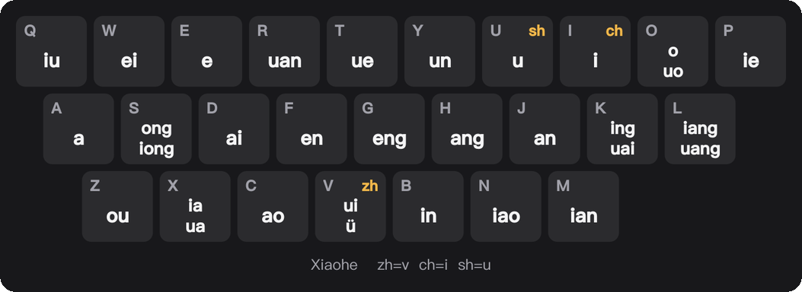
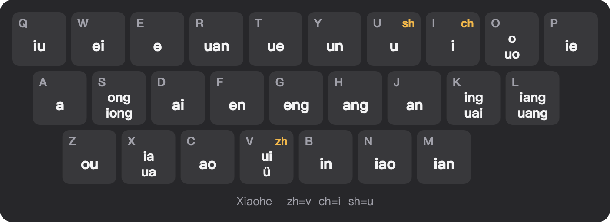
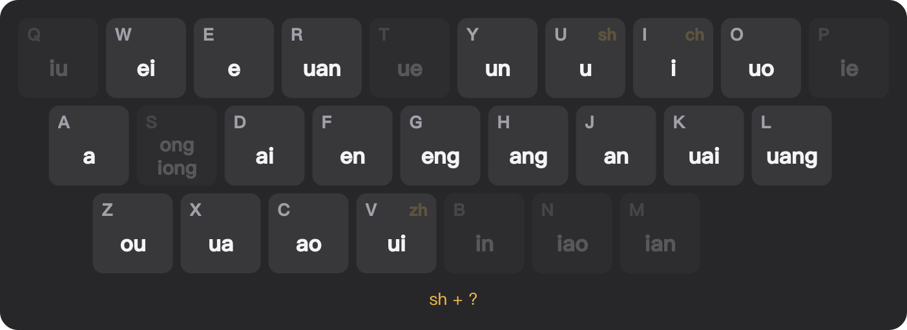
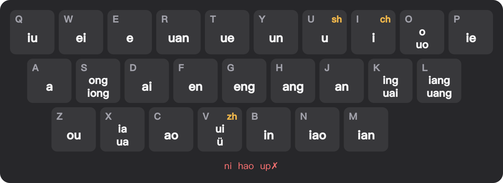

# 双拼键位浮窗（Shuangpin Overlay）

[English](README.md)

一个帮你学[双拼](https://zh.wikipedia.org/wiki/双拼)的键位图浮窗，用于 Linux 桌面。它浮在所有窗口之上，
跟着你的输入变化，不打字的时候自己消失。



| | |
| --- | --- |
|  | 平时：每个键上的韵母，zh、ch、sh 用强调色标出。 |
|  | 按下音节的第一键之后：只留下这个声母能接的韵母。 |
|  | 不存在的组合会标红。 |

八种内置方案的键位图见 [docs/schemes.md](docs/schemes.md)。

## 功能

- **八种方案**：小鹤、自然码、微软、紫光、智能 ABC、中文之星、拼音加加、国标。默认跟随 Fcitx5 里设置的方案，
  也可以自己添加。
- **跟随输入**：按下的键会高亮，底部一行实时显示已打出的音节（`vs go` → `zhong guo`），不存在的组合会标红。
- **提示下一键**：按下声母后，接不了的键变暗；一个键上有两个韵母时，只显示用得上的那个。
- **不碍事**：只在双拼输入法激活时出现，键盘空闲一会儿后自动隐藏。隐藏时鼠标点击会穿透过去。
- **陪你脱表**：打开“只在卡住时出现”后，平时保持隐藏，按下声母后停顿了才出现，越熟练越少见到它。
- **告诉你该练什么**：列出你回忆最慢的韵母，以及常按错的键（靠“删掉一个键、换成另一个键”来发现）。
- 高亮颜色跟随桌面强调色。界面支持英文和简体中文。

## 运行要求

- Linux，Wayland 或 X11
- Qt 6.5 及以上
- 对 `/dev/input/event*` 的读权限，见[键盘权限与隐私](#键盘权限与隐私)
- 可选：[LayerShellQt](https://invent.kde.org/plasma/layer-shell-qt)，用于[浮层模式](#浮层模式)
- 可选：Fcitx5，用于跟随当前输入法及其双拼方案

键位图是一个普通窗口，和其他窗口一样由窗口管理器移动。Wayland 不允许应用自己置顶，所以需要在窗口管理器里设置一次：

| 桌面 | 置顶方法 |
| --- | --- |
| KDE Plasma（Wayland） | 设一条窗口规则，见[下文](#在-kde-plasma-里置顶)。 |
| GNOME（Wayland） | 窗口菜单（Alt+空格）→“置顶”。 |
| Sway、Hyprland 等 | 给 app id `io.github.zhenban.ShuangpinOverlay` 写规则，或使用下面的浮层模式。 |
| X11 | 不需要设置。 |

目前只在 KDE Plasma 6（Wayland）上测试过。

### 在 KDE Plasma 里置顶

1. 点一下键位图，按 Alt+F3，选“更多操作 → 配置特殊窗口设置”。
2. 添加以下属性：
   - “保持在其他窗口之上”：强制，是
   - “接受焦点”：强制，否。不设的话，点到键位图会把键盘焦点从你正在输入的窗口抢走。
   - “位置”：记住
   - “跳过任务栏”：强制，是（可选）

### 浮层模式

装有 LayerShellQt 时，菜单里有“以浮层方式显示”。这时键位图是 layer-shell 浮层：自带置顶、不抢焦点、记住位置，
不需要任何设置。代价是窗口管理器不会移动这种浮层，拖动只能由程序自己实现：没那么跟手，也没有桌面的窗口特效。
它还和面板处在同一层级，可能盖住面板。

## 安装

**Fedora**：从[最新 Release](https://github.com/zhenban/shuangpin-overlay/releases/latest) 下载 `.rpm` 安装。
文件名里的 `fc44` 表示它是为 Fedora 44 构建的。

```sh
sudo dnf install ./shuangpin-overlay-*.x86_64.rpm
```

**其他发行版**：按下文从源码构建。目前还没有别的安装包，欢迎帮忙打包。

无论哪种方式，都要先设置好[键盘权限](#键盘权限与隐私)，键位图才能跟随你的输入。

## 构建

Fedora：

```sh
sudo dnf install cmake ninja-build gcc-c++ qt6-qtbase-devel qt6-qttools-devel layer-shell-qt-devel
```

Debian 和 Ubuntu（需要带 Qt 6.5 及以上的版本；包名未经验证）：

```sh
sudo apt install cmake ninja-build g++ qt6-base-dev qt6-tools-dev qt6-l10n-tools liblayershellqtinterface-dev
```

然后：

```sh
cmake -B build -G Ninja
cmake --build build
ctest --test-dir build          # 可选
cmake --install build --prefix ~/.local
```

加上 `-DWITH_LAYER_SHELL=OFF` 可以不依赖 LayerShellQt。

## 使用

从应用菜单启动**双拼键位浮窗**，或者运行 `shuangpin-overlay`。

| 操作 | 效果 |
| --- | --- |
| 拖动 | 移动键位图 |
| 滚轮 | 调整透明度 |
| Ctrl + 滚轮 | 调整大小 |
| 右键 | 菜单：方案、提示、隐藏、统计、开机启动、退出 |

键位图隐藏时点不到它；在双拼模式下按一个字母就会重新出现。

命令行：

```sh
shuangpin-overlay --list-schemes
shuangpin-overlay --export chart.png --scheme ziranma       # 把键位图存成图片
shuangpin-overlay --export hint.png --after u               # 按下 U 之后的样子
shuangpin-overlay --export typed.png --after nihcu --pressed u
```

`--after` 后面是已经按过的键，`<` 代表退格。本页的图片都是 [`docs/generate.sh`](docs/generate.sh) 这样生成的。

## 键盘权限与隐私

Wayland 不允许应用看到打给其他窗口的按键，所以本程序直接读取内核的输入设备，这需要你在 `input` 用户组里：

```sh
sudo usermod -aG input "$USER"    # 然后注销重新登录
```

请清楚这意味着什么：该组成员运行的任何程序都能读到所有按键。是否接受由你自己决定。

本程序怎么处理按键：

- 只看字母键、`;`、退格和修饰键。其他键只用来判断“这次输入结束了”。
- 正在输入的那一段按键只放在内存里，输入结束就丢弃。
- 写入磁盘的只有练习统计：每个韵母的平均回忆时间，以及“想按这个键、按成了那个键”的次数。文件在
  `~/.local/share/shuangpin-overlay/stats.json`，可以在菜单里清空。
- 不向任何地方发送数据，程序里没有网络代码。

## 添加方案

把 JSON 文件放进 `~/.local/share/shuangpin-overlay/schemes/` 后重启即可。`id` 与内置方案相同的文件会替换内置的。
格式参考 [`data/schemes`](data/schemes) 里的内置文件：

```json
{
  "id": "xiaohe",
  "name": { "en": "Xiaohe", "zh": "小鹤双拼" },
  "fcitxProfile": "Xiaohe",
  "initials": { "zh": "v", "ch": "i", "sh": "u" },
  "finals": { "ai": "d", "an": "j", "ü": "v", "üe": "t" },
  "zeroInitial": { "keys": "", "byFirstLetter": true }
}
```

- `initials`：zh、ch、sh 所在的键。单字母声母就是它自己的键。
- `finals`：两个字母以上的韵母和 `ü` 所在的键。a、o、e、i、u 默认在自己的键上。
- `zeroInitial`：零声母音节怎么打。`keys` 是代替声母的键（微软方案是 `"o"`：`oh` = ang）；`byFirstLetter`
  是小鹤和自然码的打法：`aa` = a，`an` = an，`ah` = ang。
- `fcitxProfile`：Fcitx5 的 `pinyin.conf` 里 `ShuangpinProfile` 取这个值时使用本方案。

## 局限

- “打到音节的第几键”是只靠按键猜的：字母算一键，退格退一键，其他键算结束。Fcitx5 不提供这个状态。
  用鼠标点候选字、或者打到一半切换窗口，会让提示错位一键，按一下空格就恢复。
- 按错的键只能在上屏之前发现。删除已经上屏的文字，程序看不到。
- 按键按位置识别，对应美式 QWERTY 布局。
- 没有 Fcitx5 时无法知道当前输入法，会当作双拼一直处于激活状态。使用 Fcitx5 下的其他输入法（例如 Rime）时，
  可以在 `~/.config/shuangpin-overlay.conf` 里写上要匹配的名称片段：`inputMethodNames=shuangpin, rime`。
- 不读取 Fcitx5 里的自定义方案（`ShuangpinProfile=Custom`），请另存为方案文件。

## 致谢

内置方案的键位表转换自 [libime](https://github.com/fcitx/libime)（Fcitx5 拼音引擎所用的库），
所以浮窗的判断与 Fcitx5 实际接受的输入一致。

## 许可证

[GPL-3.0-or-later](LICENSE)
