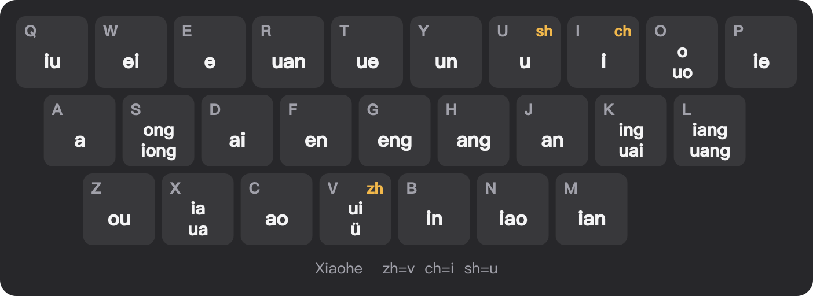
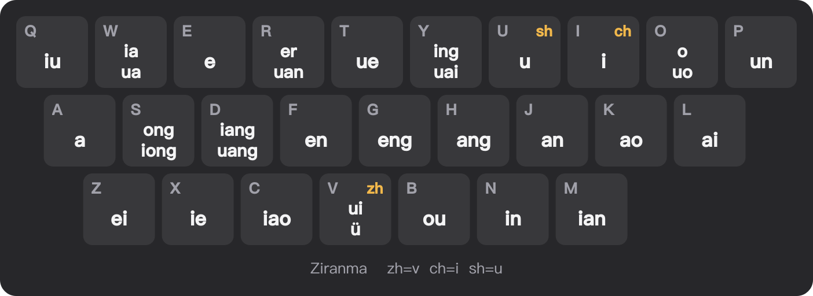
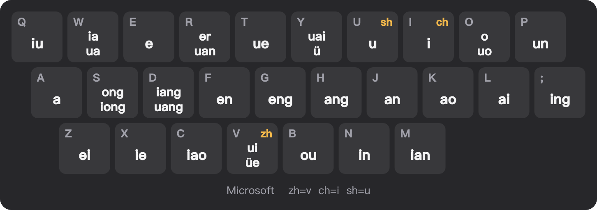
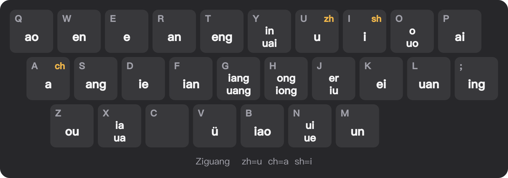
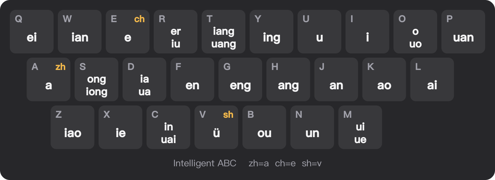
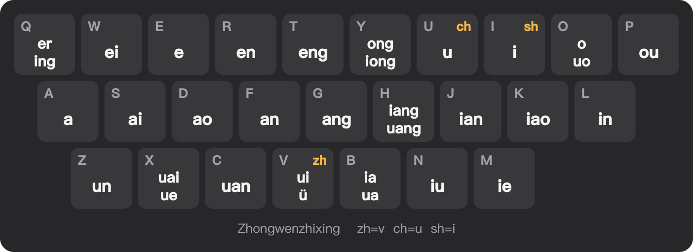
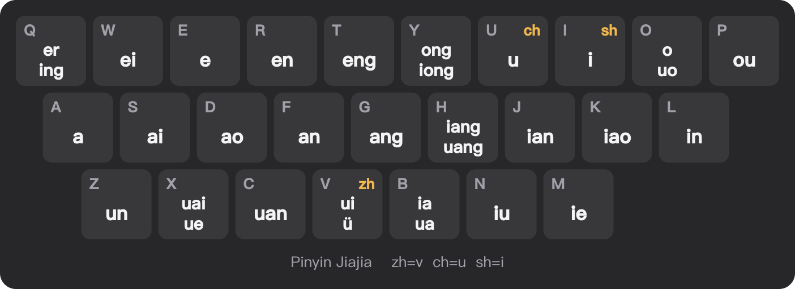
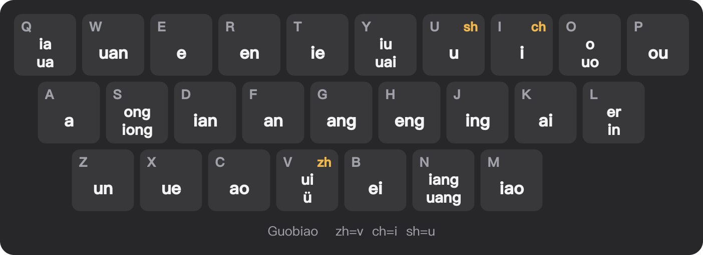

# Built-in schemes · 内置双拼方案

By default the overlay uses the scheme Fcitx5 is set to; the menu can pin another. The pictures are made by
[`generate.sh`](generate.sh). To add a scheme of your own, see
[Adding a scheme](../README.md#adding-a-scheme).

| Scheme | 方案 | `id` | Fcitx5 `ShuangpinProfile` | zh | ch | sh | Zero initial |
| --- | --- | --- | --- | --- | --- | --- | --- |
| [Xiaohe](#xiaohe) | 小鹤双拼 | `xiaohe` | `Xiaohe` | V | I | U | first letter of the final |
| [Ziranma](#ziranma) | 自然码 | `ziranma` | `Ziranma` | V | I | U | key O, first letter of the final |
| [Microsoft](#microsoft) | 微软双拼 | `microsoft` | `MS` | V | I | U | key O |
| [Ziguang](#ziguang) | 紫光双拼 | `ziguang` | `Ziguang` | U | A | I | key O |
| [Intelligent ABC](#intelligent-abc) | 智能 ABC | `abc` | `ABC` | A | E | V | key O |
| [Zhongwenzhixing](#zhongwenzhixing) | 中文之星 | `zhongwenzhixing` | `Zhongwenzhixing` | V | U | I | key O |
| [Pinyin Jiajia](#pinyin-jiajia) | 拼音加加 | `pinyinjiajia` | `PinyinJiajia` | V | U | I | key O, first letter of the final |
| [Guobiao](#guobiao) | 国标双拼 | `guobiao` | `GB` | V | I | U | key A |

"Zero initial" is how a syllable without an initial is typed: with a key that stands for the missing
initial (`oh` = ang in Microsoft), or starting with the first letter of the final (`aa` = a, `an` = an,
`ah` = ang in Xiaohe).

## Xiaohe

小鹤双拼

## Ziranma

自然码

## Microsoft

微软双拼

## Ziguang

紫光双拼

## Intelligent ABC

智能 ABC

## Zhongwenzhixing

中文之星

## Pinyin Jiajia

拼音加加

## Guobiao

国标双拼

